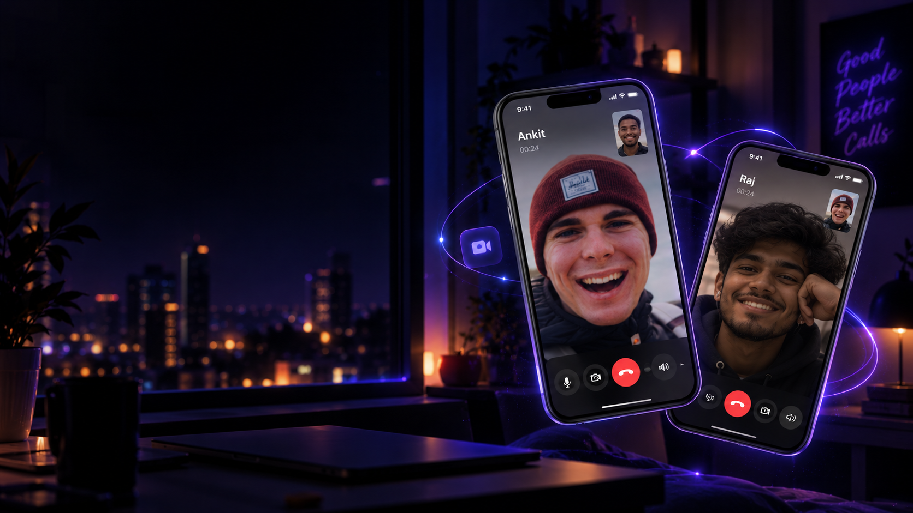
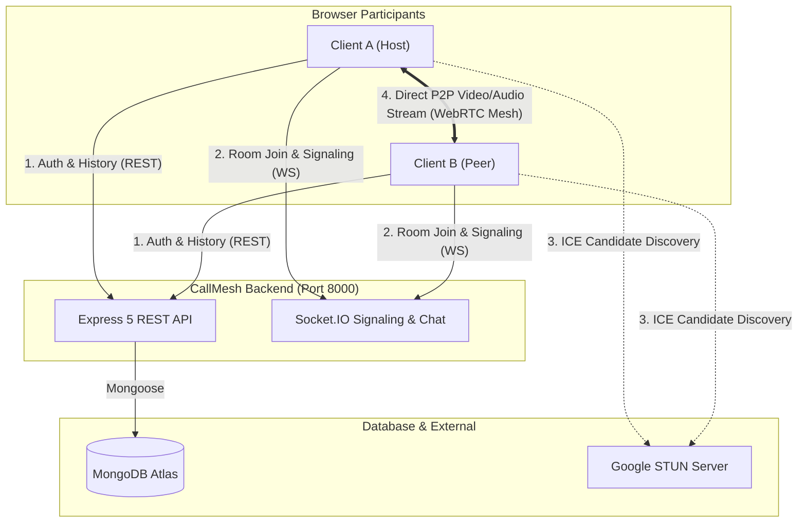

# CallMesh

> **Connect with your people. Real-time video calls, built for the web.**

CallMesh is a modern, lightweight, browser-based video calling and conferencing application. Built with a decentralized WebRTC mesh architecture and Socket.IO signaling, CallMesh delivers instant peer-to-peer video meetings, real-time in-call messaging, camera-off fallback avatars, and meeting history tracking inside a responsive dark glassmorphism interface.

---

## Features

- **Peer-to-Peer Video & Audio Calling:** Direct browser-to-browser media streaming powered by native WebRTC (`RTCPeerConnection`).
- **Instant Meeting Rooms & Shareable Codes:** Generate private meeting rooms or join with custom room codes directly via `/room-id` URLs.
- **Microphone & Camera Hardware Controls:** Independent audio and video track toggles with hardware-level track control.
- **Camera-Off Avatar Fallback:** When a participant turns their camera off, video tiles seamlessly transition to a circular initials avatar badge (e.g., **A** for Ankit, **R** for Raj) with an active "Camera Off" status pill.
- **Zero-Latency Video Restoration:** Camera re-enabling restores live video streams instantly without renegotiating WebRTC SDP offers or refreshing.
- **In-Call Real-Time Chat:** Low-latency room-scoped messaging via Socket.IO featuring distinct message styling (gradient bubbles for sent messages, dark slate for received), sender display names, localized timestamps, and automatic scroll-to-bottom.
- **Screen Sharing Support:** One-click screen sharing leveraging browser `getDisplayMedia` with automatic fallback to the camera track upon termination.
- **Email Registration & Dual-Identifier Authentication:** Secure account creation requiring full name, RFC-validated email, unique username, and password. Supports login using either email or username, preserving backward compatibility for legacy accounts.
- **Meeting History Tracking:** Persistent meeting activity logging backed by MongoDB Atlas, enabling authenticated users to review past calls and rejoin with one click.
- **Dark Glassmorphism Interface:** Polished UI featuring a deep indigo/violet color palette, neon cyan accents, custom dark scrollbars, and mobile-responsive layouts.
- **Developer Attribution & Social Links:** Built-in About section highlighting project design and verified links to developer portfolio and LinkedIn profiles.

---

## Screenshots

### Hero & Landing Page


### Conference & Chat Views
> *Meeting room screenshots showcasing multi-peer video tiles, in-call chat panel, and avatar fallbacks will be updated here.*

---

## Technology Stack

### Frontend
- **Framework:** [React 19](https://react.dev/) (`^19.1.1`)
- **Build Tool:** [Vite 7](https://vitejs.dev/) (`^7.1.7`)
- **Routing:** [React Router DOM 7](https://reactrouter.com/) (`^7.18.4`)
- **Component Library:** [Material UI (MUI v9)](https://mui.com/) (`@mui/material`, `@mui/icons-material`, `@emotion/react`, `@emotion/styled`)
- **HTTP Client:** [Axios](https://axios-http.com/) (`^1.20.0`)
- **Signaling Client:** [Socket.IO Client](https://socket.io/) (`^4.8.4`)
- **Styling:** CSS Modules (`videoComponent.module.css`) and global glassmorphism stylesheets (`App.css`, `index.css`)

### Backend
- **Runtime:** [Node.js](https://nodejs.org/) (v20+ / v22 LTS recommended)
- **Web Framework:** [Express 5](https://expressjs.com/) (`^5.1.0`)
- **Signaling Server:** [Socket.IO 4.8](https://socket.io/) (`^4.8.1`)
- **Database ODM:** [Mongoose 8](https://mongoosejs.com/) (`^8.17.1`)
- **Security & Hashing:** [bcrypt](https://www.npmjs.com/package/bcrypt) (`^6.0.0`) and Node `crypto`
- **CORS Middleware:** [cors](https://www.npmjs.com/package/cors) (`^2.8.5`)

### Database & Real-Time Infrastructure
- **Database:** MongoDB Atlas (Cloud Replica Set)
- **Real-Time Protocol:** WebSockets via Socket.IO
- **Media Engine:** WebRTC P2P mesh using Google STUN (`stun:stun.l.google.com:19302`)

---

## Architecture

CallMesh utilizes a hybrid architecture:
1. **HTTP / REST Layer:** Handles user authentication, token issuance, and meeting activity persistence through Express routes connecting to MongoDB Atlas.
2. **WebSocket Signaling Layer:** Socket.IO orchestrates room lifecycle, SDP offer/answer exchange, ICE candidate routing, camera-state broadcasts, and room-scoped chat messages.
3. **P2P WebRTC Mesh Layer:** Audio and video media tracks are streamed directly between browsers through peer connections without passing media through the server.



---

## Prerequisites

Before running CallMesh locally, ensure you have:
- **Node.js:** v20.0.0 or higher (v22.14 LTS recommended)
- **npm:** v10.0.0 or higher
- **MongoDB Atlas:** An active MongoDB connection string (or a local MongoDB instance).
- **Web Browser:** A modern browser supporting WebRTC and `navigator.mediaDevices` (Google Chrome, Mozilla Firefox, Microsoft Edge, or Apple Safari).

---

## Installation & Setup

### 1. Clone the Repository
```bash
git clone https://github.com/Ankitt-02/callmesh.git
cd callmesh
```

### 2. Configure the Backend
Navigate to the `backend/` directory, install dependencies, and create your environment configuration:
```bash
cd backend
npm install
cp .env.example .env
```

Open `backend/.env` and insert your MongoDB connection URI:
```env
PORT=8000
MONGODB_URI=mongodb+srv://<username>:<password>@<cluster>/<database>?retryWrites=true&w=majority
```

> **Security Note:** Never commit `backend/.env` or share your actual database credentials. The `.gitignore` file is configured to keep `.env` strictly local.

### 3. Configure the Frontend
In a separate terminal (or after configuring the backend), navigate to the `frontend/` directory and install dependencies:
```bash
cd ../frontend
npm install
cp .env.example .env
```

The frontend defaults to `http://localhost:8000` for backend communication. If needed, configure `frontend/.env`:
```env
VITE_BACKEND_URL=http://localhost:8000
```

---

## Running Locally

Run both the backend and frontend in separate terminals:

### Terminal 1 — Start the Backend Server
```bash
cd backend
npm run dev
```
*The backend starts at `http://localhost:8000` and establishes a connection to MongoDB Atlas.*

### Terminal 2 — Start the Frontend Development Server
```bash
cd frontend
npm run dev
```
*The frontend Vite dev server starts at `http://localhost:8080`.*

### Verify Service Health
Test that the backend and database connection are operational:
```bash
curl http://localhost:8000/health
```
**Expected response:**
```json
{"status":"healthy","database":"connected"}
```

Access the application in your browser at:
**`http://localhost:8080`**

---

## Environment Variables

| Variable | Location | Required | Default | Description |
|:---|:---:|:---:|:---:|:---|
| `MONGODB_URI` | `backend/.env` | **Yes** | *None* | MongoDB connection URI (Atlas connection string or local MongoDB instance). |
| `PORT` | `backend/.env` | No | `8000` | Port for the Express REST server and Socket.IO listener. |
| `VITE_BACKEND_URL` | `frontend/.env` | No | `http://localhost:8000` | Base URL of the backend API and Socket.IO service consumed by the React app. |

---

## API & Real-Time Communication

### REST Endpoints

| Method | Endpoint | Auth Required | Description |
|:---|:---|:---:|:---|
| `GET` | `/health` | No | Returns system and MongoDB connection health status. |
| `POST` | `/api/v1/users/register` | No | Creates a new account (`name`, `username`, `email`, `password`). |
| `POST` | `/api/v1/users/login` | No | Authenticates user via email or username and password; returns token and user object. |
| `POST` | `/api/v1/users/add_to_activity` | **Yes** | Records a meeting code to the user's meeting history (`token`, `meeting_code`). |
| `GET` | `/api/v1/users/get_all_activity` | **Yes** | Retrieves chronological meeting history for the authenticated user (`token`). |

### Socket.IO Real-Time Events

| Event Name | Direction | Payload | Description |
|:---|:---:|:---|:---|
| `join-call` | Client &rarr; Server | `(roomPath, displayName)` | Joins the specified room, notifies existing peers, and replays chat history. |
| `user-joined` | Server &rarr; Client | `(newSocketId, clientsList, userMeta)` | Informs room peers of a new participant and provides metadata (usernames, camera states). |
| `signal` | Bidirectional | `(targetSocketId, sdpOrIcePayload)` | Securely routes WebRTC SDP offers, answers, and ICE candidates between peers in the same room. |
| `chat-message` | Client &rarr; Server &rarr; Room | `(text, sender, timestamp)` | Broadcasts an in-call chat message to all peers connected to the room. |
| `camera-state` | Bidirectional | `(socketId, isCameraOn)` | Notifies peers when a user enables or disables their video camera to trigger avatar fallback. |
| `user-info` | Bidirectional | `(socketId, username, cameraOn)` | Synchronizes participant display names and initial camera status across peers. |
| `user-left` | Server &rarr; Client | `(disconnectedSocketId)` | Notifies remaining room participants to close the associated `RTCPeerConnection` and remove the video tile. |

---

## Project Structure

```
callmesh/
├── backend/
│   ├── src/
│   │   ├── controllers/
│   │   │   ├── socketManager.js       # Socket.IO signaling, room lifecycle & chat
│   │   │   └── user.controller.js     # Auth & meeting history controllers
│   │   ├── models/
│   │   │   ├── meeting.model.js       # Meeting activity schema
│   │   │   └── user.model.js          # User schema (email, username, bcrypt)
│   │   ├── routes/
│   │   │   └── users.routes.js        # Express user & activity routes
│   │   └── app.js                     # Express app initialization & MongoDB connect
│   ├── .env.example                   # Safe backend environment template
│   ├── .gitignore                     # Backend ignore rules (prevents .env commit)
│   ├── package.json
│   └── package-lock.json
├── frontend/
│   ├── public/
│   │   ├── Neon Night Video Call Connection .png  # Hero background asset
│   │   └── vite.svg
│   ├── src/
│   │   ├── contexts/
│   │   │   └── AuthContext.jsx        # Persistent auth context & token management
│   │   ├── pages/
│   │   │   ├── authentication.jsx     # Dark glass Sign In / Sign Up modal
│   │   │   ├── history.jsx            # Meeting history log with one-click rejoin
│   │   │   ├── home.jsx               # Dashboard, instant meeting & room code join
│   │   │   ├── landing.jsx            # Landing page with hero, features & About
│   │   │   ├── VideoMeet.jsx          # WebRTC conference view, chat & controls
│   │   │   └── withAuth.jsx           # Protected route higher-order component
│   │   ├── styles/
│   │   │   └── videoComponent.module.css # In-call conference grid, tiles & chat styles
│   │   ├── App.css                    # CallMesh glassmorphism design system
│   │   ├── App.jsx                    # Routing & context tree
│   │   ├── environment.js             # Configurable backend base URL export
│   │   ├── index.css                  # Base reset & dark theme variables
│   │   └── main.jsx                   # React entry point
│   ├── .env.example                   # Safe frontend environment template
│   ├── .gitignore                     # Frontend ignore rules
│   ├── index.html
│   ├── package.json
│   ├── package-lock.json
│   └── vite.config.js
├── docs/
│   ├── screenshots/
│   │   └── landing-hero.png           # Public documentation screenshots
│   └── CALLMESH_AUDIT_REPORT.md       # Comprehensive multi-phase audit report
├── .env.example                       # Root-level environment template
├── .gitignore                         # Root gitignore rules
└── README.md
```

---

## Testing & Verification

### Build Verification
Compile the production frontend bundle to verify modules and type compatibility:
```bash
npm --prefix frontend run build
```
**Outcome:** `1064 modules transformed in ~4.0s (0 errors).`

### Automated Test Suites Executed
1. **Real-Browser Automation (Headless Chrome CDP):**
   - Verified landing page hero asset loading and 4-card 2 × 2 feature grid.
   - Verified 375px mobile viewport responsiveness with zero horizontal scroll overflow.
   - Tested registration with RFC email validation, password mismatch checks, and auto-switching to Sign In.
   - Tested dual-identifier login with email and password.
   - Verified session persistence across page reloads (`localStorage.token` and `username`).
   - Tested protected route enforcement: unauthenticated access to `/home` redirects to `/auth`.
2. **Multi-Participant WebRTC Calling & Media Pipeline:**
   - Two headless Chrome instances joined the same room simultaneously.
   - Verified bidirectional SDP offer/answer negotiation and ICE candidate exchange.
   - Verified active remote video tile playback with `data-socket` attributes.
   - Tested camera toggles: verified local and remote video tiles transition to `ParticipantAvatar` with initials (`A`) and "Camera Off" badges.
   - Tested zero-latency camera restoration: re-enabling video instantly restored video playback without renegotiation.
   - Tested in-call messaging: real-time message transmission from Client A to Client B with sender attribution, localized timestamps, and violet/slate bubble styling.
   - Tested disconnection: Client A leaving triggers `user-left` cleanup, removing remote tiles on remaining peers.
3. **Database & API Regression Suite:**
   - 10/10 automated tests passing for MongoDB Atlas user registration, duplicate email/username rejection, dual-identifier login, and meeting activity logging.

> **Testing Note:** Multi-client browser tests were executed using headless Google Chrome with synthetic media flags (`--use-fake-device-for-media-stream`). Physical two-device multi-hardware WebRTC camera testing in production network conditions remains unverified.

---

## Security Notes

1. **Environment Secrets:** Never commit `.env` files or hardcode database credentials in client code. Keep `MONGODB_URI` strictly server-side.
2. **CORS Restrictions:** For public deployment, restrict the `cors()` origin in `backend/src/app.js` and `backend/src/controllers/socketManager.js` to your production frontend domain rather than wildcard `*`.
3. **HTTPS / Secure Contexts:** Modern browsers mandate secure contexts (`https://` or `localhost`) for `navigator.mediaDevices.getUserMedia` and `getDisplayMedia`. Deploy behind valid SSL/TLS certificates in production.
4. **TURN Relay Infrastructure:** WebRTC peer-to-peer streaming functions directly when NAT allows it (or via STUN). For enterprise firewalls, symmetric NATs, or restrictive cellular carriers, integrate a TURN relay server (e.g., Coturn or Xirsys) into `peerConfigConnections` in `frontend/src/pages/VideoMeet.jsx`.

---

## Current Limitations & Roadmap

- **Mesh Topology Scalability:** The current direct peer-to-peer mesh architecture creates $N \times (N - 1)$ connections, which is optimal and resource-efficient for 2–4 participants. For larger meetings (>4 peers), consider integrating a Selective Forwarding Unit (SFU) such as Mediasoup or LiveKit.
- **TURN Server Integration:** Production deployments across restricted networks require configuring dedicated TURN server credentials in `RTCPeerConnection` iceServers.
- **Bundle Optimization:** Large vendor packages (`@mui/material`, `@emotion/react`) can be further split using Rollup `manualChunks` in `vite.config.js`.

---

## Author

**Ankit Swami**

- **Portfolio:** [https://ankit02.vercel.app/](https://ankit02.vercel.app/)
- **LinkedIn:** [https://www.linkedin.com/in/ankit-swami-161b80301/](https://www.linkedin.com/in/ankit-swami-161b80301/)

---

## License

This project is licensed under the ISC License.
